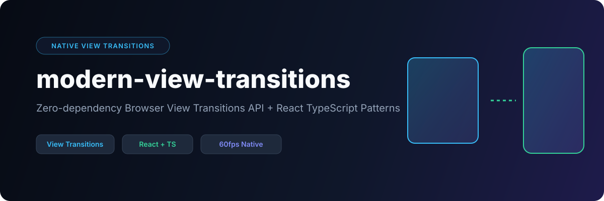
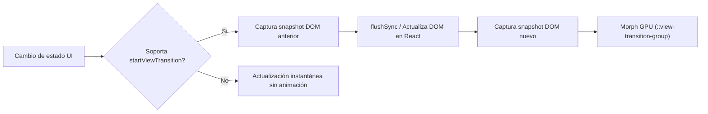

<p align="right">
  <a href="./README.md">🇺🇸 Read in English</a>
</p>

<p align="center">
  
</p>

<p align="center">
  
  
  
  
</p>

# Modern View Transitions

Implementación práctica y ligera de la **API nativa View Transitions** (`document.startViewTransition`) en **React + TypeScript + Vite** para lograr transiciones fluidas entre estados y elementos compartidos a 60fps sin depender de librerías pesadas de animación.

---

## Cómo funciona



---

## Inicio rápido

```bash
git clone https://github.com/stephanocamoretti-dotcom/modern-view-transitions.git
cd modern-view-transitions
npm install
npm run dev
```

---

## Referencias

- [MDN Web Docs — View Transitions API](https://developer.mozilla.org/en-US/docs/Web/API/View_Transition_API)
- [Chrome for Developers — Smooth Transitions with the View Transitions API](https://developer.chrome.com/docs/web-platform/view-transitions)
