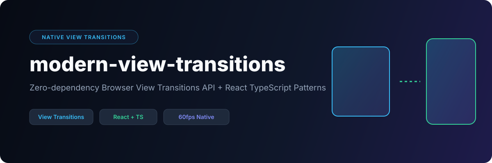
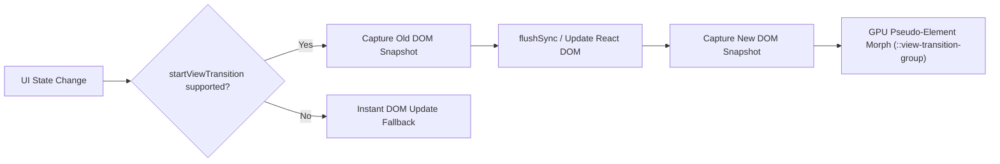

<p align="right">
  <a href="./README.es.md">🇪🇸 Leer en Español</a>
</p>

<p align="center">
  
</p>

<p align="center">
  
  
  
  
</p>

# Modern View Transitions

A lightweight, practical showcase of the **native Browser View Transitions API** (`document.startViewTransition`) in **React + TypeScript + Vite**—delivering smooth shared-element morphs and route/state transitions at 60fps without heavy animation libraries.

---

## How It Works



---

## Quick Start

```bash
git clone https://github.com/stephanocamoretti-dotcom/modern-view-transitions.git
cd modern-view-transitions
npm install
npm run dev
```

---

## References

- [MDN Web Docs — View Transitions API](https://developer.mozilla.org/en-US/docs/Web/API/View_Transition_API)
- [Chrome for Developers — Smooth Transitions with the View Transitions API](https://developer.chrome.com/docs/web-platform/view-transitions)
